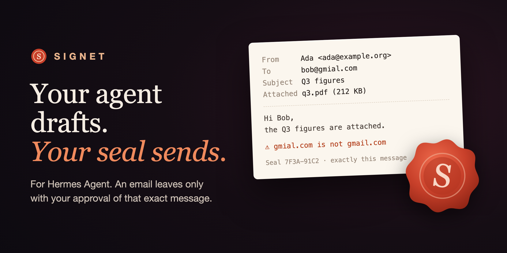

# Signet

**An email leaves your Hermes agent only with your seal on that exact message.**



Agents send email now. A line in a prompt that says "always ask me first" is a wish: the model can
skip it, a long session can forget it, a page the agent read can talk it out of it, and YOLO mode
switches the question off altogether. Signet makes it a rule that code enforces.

- **You approve the real thing.** Recipients, sender, subject, text and attachments are shown in
  Hermes's own approval prompt, on whatever surface you use: CLI, TUI, Desktop, Telegram, Discord,
  Slack. What the card shows is what a mail client will show: names and subjects are written the
  way the reader will see them, and anything that would display differently is refused.
- **Your yes is tied to the bytes.** The approval is a seal on the SHA-256 of the message you saw.
  Signet builds the outgoing mail from those fields only and checks the fingerprint again when it
  sends. A recipient added, a sentence changed or an attachment swapped after the prompt is a
  different message: it has no seal and does not leave.
- **Only a person can seal.** YOLO mode, `approvals.mode: off`, a timeout and a scheduled run
  produce no seal. The email is held, and you send it yourself with `/signet send CODE`, after
  Signet has shown it to you in full.
- **The usual side doors are shut.** `himalaya message send`, `msmtp`, `sendmail`, `mail`, `mutt`,
  `swaks`, SMTP scripts, mail SDKs and the send endpoints of hosted mail APIs are blocked when the
  agent tries them directly, with a message that points it back to the sealed path. Commands are
  read the way a shell reads them, so `git commit -m "fix msmtp docs"` is left alone.
- **The card points at what a careful reader would check.** A domain that imitates one you know
  (`gmial.com`, `examp1e.org`), a new recipient, a name that shows another address, a token or a
  private key in the text, a link to a bare IP, invisible characters removed. All of it is
  computed locally, with no model.
- **Decisions are on record.** Sent, denied, held, dropped, blocked: one line each in a local
  ledger, with the fingerprint and how it was sealed.

No account, no service, no dependency: the Python standard library and Hermes's own hooks.

## What you see

When the agent calls `signet_send_mail`, Hermes asks you, with this as the reason:

```text
Seal E3C1-2114: approve to send exactly this email
To:      bob@gmial.com
⚠ bob@gmial.com: looks like gmail.com but is not
From:    Ada <ada@example.org>
Subject: Q3 figures
Attached: q3.pdf (212 KB, sha256 0e1c23c4415c…)
          from /home/ada/reports/q3.pdf
New recipient: bob@gmial.com
│ Hi Bob,
│ the Q3 figures are attached. Call me if anything looks off.
│ Ada
Seal E3C1-2114 covers exactly this message (71 characters). Any change needs a new seal.
```

The recipients and the warnings come first, because the classic Hermes CLI shows only the first ten
rows of an approval reason. The lines of the email's own text carry a `│` mark, so the text cannot
pass for a line of the card.

Approve, and that message goes out. Deny, and it does not; it stays in your outbox for a day in case
you want to read it in full or send it after all. Do nothing, and it waits:

```text
/signet
Signet. Transport: command (himalaya message send).
Guard on direct mailers: block; in scheduled runs: block.
Default sender: Ada <ada@example.org>.

1 email(s) waiting for you:
  E3C1-2114  to bob@gmial.com  “Q3 figures”  (the approval prompt timed out)

/signet show CODE to read one, /signet send CODE to seal and send it, /signet drop CODE to discard it.
```

## How it works

```text
model ── signet_send_mail(to, subject, body, …)
           │
           ▼
   pre_tool_call hook      canonical draft → SHA-256 → card
           │               returns {"action": "approve", message: card, rule_key: one-time}
           ▼
   Hermes approval gate    asks the person (CLI, Desktop, Telegram, …)
           │
           ▼
   post_approval_response  a person's yes → seal(SHA-256), in memory, single use
           │
           ▼
   tool handler            rebuilds the draft from the arguments it really received
                           seal for that SHA-256?  yes → send once, write the ledger
                                                   no  → hold for /signet send CODE
```

Four details carry the guarantee:

1. **The seal comes from the hook, not from the gate's return value.** When Hermes skips the
   prompt (YOLO, approvals off), the gate says "approved" but no person answered, so
   `post_approval_response` reports no human choice and there is no seal.
2. **Each showing has its own rule key.** If you answer "always", Hermes stores a rule that matches
   that one showing and nothing after it: the next email is asked about again. Answer "once"; the
   other two only leave an unused entry in Hermes's allowlist.
3. **Seals live in the memory of the Hermes process.** Nothing the agent writes to disk becomes
   one.
4. **`/signet send` seals what it has shown.** A held email is a file. Before sending it, Signet
   passes it through the same checks as a fresh draft, hashes its attachments again, and, unless
   you have just read it with `/signet show`, prints it in full and waits for a second
   `/signet send`. A file planted or swapped in the outbox is read to you like any other.

## Install

```bash
hermes plugins install signet          # from the Hermes plugin catalog
# or, straight from this repository:
hermes plugins install Wecko-ai/hermes-signet
hermes plugins enable signet
```

Signet needs Hermes 0.23.0 or newer. Out of the box its transport is `outbox`: approved emails are
written as `.eml` files under the plugin's data and nothing is delivered, so you can try the whole
flow safely. Then pick how mail really leaves.

**A mailer you already use** (it keeps its own configuration; Signet never reads it):

```bash
hermes config set plugins.entries.signet.settings.transport command
hermes config set plugins.entries.signet.settings.send_command '["himalaya", "message", "send"]'
hermes config set plugins.entries.signet.settings.from_address 'Ada <ada@example.org>'
```

`send_command` is a list of words, run without a shell, that reads one RFC 5322 message on
standard input: `["msmtp", "-t"]` and `["sendmail", "-t", "-i"]` work the same way.

**An SMTP server:**

```bash
hermes config set plugins.entries.signet.settings.transport smtp
hermes config set plugins.entries.signet.settings.smtp_host smtp.example.org
hermes config set plugins.entries.signet.settings.smtp_username ada@example.org
```

and store the password as the secret `SIGNET_SMTP_PASSWORD` (the plugin's settings page in Hermes
Desktop has a field for it; Signet reads it through Hermes's secret scope).

In Hermes Desktop, every setting below has a row under Settings → Plugins → Signet.

## Commands

| Command | What it does |
|---|---|
| `/signet` | Transport, guard mode, and the emails waiting for you |
| `/signet show CODE` | A held email in full, with its notes |
| `/signet send CODE` | Your seal on that held email, then one send. If you have not just read it, it is shown first and sent on the second call |
| `/signet drop CODE` | Discard a held email |
| `/signet log [N]` | The last N ledger entries |

Slash commands are typed by a person; the model cannot call them. The model has two tools:
`signet_send_mail`, and the read-only `signet_outbox` so it can answer "did my email go out?".

## Settings

| Key | Default | Meaning |
|---|---|---|
| `transport` | `outbox` | `outbox` (write `.eml`, deliver nothing), `command` or `smtp` |
| `from_address` | empty | Sender used when the agent names none |
| `send_command` | `[himalaya, message, send]` | Mailer for the `command` transport |
| `smtp_host`, `smtp_port`, `smtp_security`, `smtp_username` | | For the `smtp` transport. `smtp_security: none` is accepted for a server on the same machine only |
| `send_timeout` | `60` | Seconds the transport may take |
| `allowed_from` | empty | When set, drafts from any other sender are refused |
| `trusted_recipients` | empty | Your own addresses. An email whose every recipient is listed is sent without a prompt, also from a scheduled run |
| `guard` | `block` | Direct mailers in a conversation: `block`, `approve` (ask you through Hermes's prompt) or `off` |
| `cron_guard` | `block` | Direct mailers in scheduled runs: `block` or `allow` (keep cron jobs that mail with their own commands working) |
| `max_recipients` | `20` | A draft with more is refused |
| `preview_chars` | `900` | Characters of the text shown in the prompt. A longer text shows its start and end; `/signet show CODE` shows all of it |
| `seal_header` | `false` | Add `X-Signet-Seal: <sha256>` to sent mail, to match it to the ledger |

## Long emails and narrow prompts

A prompt is not always the place to read a long email: the classic CLI cuts the reason after ten
rows, and Signet itself shows the start and the end of a text longer than `preview_chars`. In both
cases the card says so on its second line. Deny, read the whole email with `/signet show CODE`,
then `/signet send CODE`. The email that leaves is the one you read.

If the text contains something Hermes masks on approval surfaces (an API key, a password), the
card warns that what you see as `***` is sent in clear.

## Scheduled runs

A cron job has nobody to ask. Signet does not pretend otherwise:

- an email to `trusted_recipients` only (your own address) is sent, so daily reports keep arriving;
- any other email is held, and shows up under `/signet` the next time you look;
- direct mailers follow `cron_guard`.

## What Signet does not do

Signet is a set of trusted hooks, not a sandbox. Be clear about the line:

- It stops the mistakes and manipulations that happen in practice: a wrong or invented recipient,
  a message that drifted from what was discussed, an agent talked into mailing something by a web
  page or an inbox, a session left in YOLO mode.
- It does not contain an agent that sets out to defeat it with a shell. Such an agent can write a
  mailer the guard has never heard of, hide a command from it (`h=msmtp; $h -t`), or edit the
  plugin. If that is your threat, run the agent's terminal in a container without network access
  to your mail server, and keep `guard: block` as the second line.
- The guard knows a list of mailers, libraries and mail APIs (see `guard.py` and the tables in
  `tests/test_guard.py`). It is a list, so it is incomplete by nature.
- `trusted_recipients` is the one case where an email leaves without a prompt: you list the
  addresses, and only an email sent to nobody else qualifies.
- Replies that a mail *platform adapter* delivers as the agent's normal answer are not tool calls
  and do not pass through Signet.
- There is no Bcc, no Reply-To and no HTML body in this version: every recipient and every word is
  on the card. A reply carries the id of the mail it answers (`In-Reply-To`, shown on the card).

## Disclosure

- **Network:** none, unless you choose the `smtp` transport, which connects to the server you set.
  No telemetry, no update check, no third-party service.
- **Shell commands:** only with the `command` transport: the one mailer you configured, run
  without a shell, with the approved message on standard input.
- **Reads outside the plugin's data:** the attachments an email names, shown to you by name, full
  path, size and hash before anything is sent. Credential files are refused by name and place
  (`.env`, `auth.json`, `.netrc`, `.git-credentials`, key stores, `.ssh/`, `.aws/`, `.config/gh/`
  and similar) and by content (any file holding a private key).
- **Stored data:** held drafts (full text, at most 200, a denied one for a day), the ledger
  (addresses, subjects, fingerprints, no bodies) and, with the `outbox` transport, the written
  `.eml` files, all under `<HERMES_HOME>/plugin-data/signet/` with owner-only permissions.
- **Credentials:** the SMTP password, read through Hermes's secret scope when the `smtp` transport
  signs in. Signet reads no `.env`, no `auth.json`, no other tool's configuration.
- **Background processes:** none.
- **Approvals:** Signet adds a prompt in front of email and never answers one. It does not change
  Hermes's approval settings. With `guard: block` it refuses tool calls that would send mail
  directly, and it blocks `signet_send_mail` itself if its own hook fails (fail closed).

## Tests

```bash
python3 -m unittest discover -s tests -t tests            # the whole flow, without Hermes
hermes plugins validate . --install-deps                   # what the catalog CI runs

# against a real Hermes, in a throwaway home, with Hermes's own Python:
HERMES_AGENT_DIR=~/.hermes/hermes-agent ~/.hermes/hermes-agent/venv/bin/python tests/hermes_integration.py
```

The unit tests need nothing but Python 3.11+. They cover the fingerprint, header injection,
encoded words and accented names (the card against the bytes on the wire), invisible characters,
look-alike domains, the guard's block and allow tables and its running time on hostile input,
single-use seals, tampering between prompt and send, held drafts edited, forged or swapped on disk,
nonsense settings, and the three transports (with a local SMTP sink).

`tests/hermes_integration.py` loads the plugin with the real Hermes plugin manager and sends
`signet_send_mail` through the real tool dispatch and approval gate, with a callback standing in
for the person and no model call: a yes, a no, YOLO mode, `approvals.mode: off`, the guard, a
process with nobody to ask, and an "always allow" answer followed by a second send. CI runs it on
Hermes v0.23.0 and v0.23.1, next to the catalog validator.

## License

MIT. From the makers of [HermesBot](https://github.com/Wecko-ai/hermes-bot), a desktop app for
running a team of Hermes agents.
